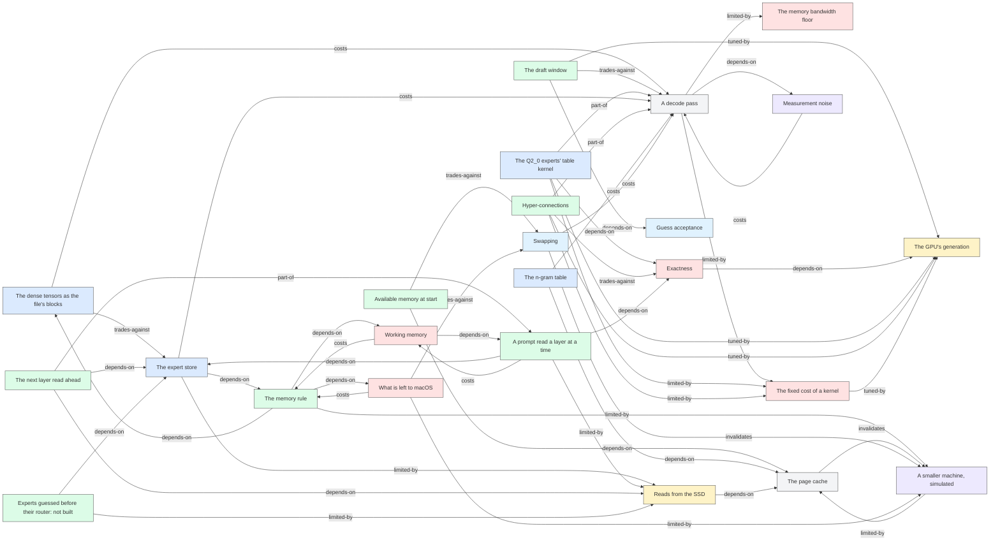

# The relations

> 中文摘要:概念之间的关系图,由 `tools/wiki_check.py --write` 生成,不要手改。箭头从一个概念指向它影响或依赖的概念。

Written by `tools/wiki_check.py --write` from the `## Relations` of every concept page. Do not edit.

Colours by kind: component, concept, constraint, hardware, mechanism, method, metric.

| from | relation | to | evidence |
| :--- | :--- | :--- | :--- |
| [Available memory at start](concepts/available-memory.md) | depends-on | [The page cache](concepts/page-cache.md) | trprrzsw (ac0523f), ooosmwnq (a916386) |
| [Available memory at start](concepts/available-memory.md) | trades-against | [Swapping](concepts/swapping.md) | #6 |
| [A decode pass](concepts/decode-pass.md) | limited-by | [The memory bandwidth floor](concepts/bandwidth-floor.md) | ROADMAP: Faster answers |
| [A decode pass](concepts/decode-pass.md) | limited-by | [The fixed cost of a kernel](concepts/kernel-fixed-cost.md) | ROADMAP: Now: what is left, #9 |
| [A decode pass](concepts/decode-pass.md) | depends-on | [Measurement noise](concepts/measurement-noise.md) | e45 |
| [The dense tensors as the file's blocks](concepts/dense-blocks.md) | costs | [A decode pass](concepts/decode-pass.md) | e36 |
| [The dense tensors as the file's blocks](concepts/dense-blocks.md) | trades-against | [The expert store](concepts/expert-store.md) | e36 |
| [The draft window](concepts/draft-window.md) | depends-on | [Guess acceptance](concepts/guess-acceptance.md) | e13 |
| [The draft window](concepts/draft-window.md) | trades-against | [A decode pass](concepts/decode-pass.md) | e45 |
| [The draft window](concepts/draft-window.md) | tuned-by | [The GPU's generation](concepts/gpu-generation.md) | e45, zryukqou (5d1a240) |
| [Exactness](concepts/exactness.md) | depends-on | [The GPU's generation](concepts/gpu-generation.md) | #5 |
| [The Q2_0 experts' table kernel](concepts/expert-lookup-kernel.md) | part-of | [A decode pass](concepts/decode-pass.md) | e06 |
| [The Q2_0 experts' table kernel](concepts/expert-lookup-kernel.md) | tuned-by | [The GPU's generation](concepts/gpu-generation.md) | e44, e45, #9 |
| [The Q2_0 experts' table kernel](concepts/expert-lookup-kernel.md) | limited-by | [The fixed cost of a kernel](concepts/kernel-fixed-cost.md) | #9, wlqvqpzr (79ace94) |
| [The Q2_0 experts' table kernel](concepts/expert-lookup-kernel.md) | depends-on | [Exactness](concepts/exactness.md) | e44 |
| [The expert store](concepts/expert-store.md) | costs | [A decode pass](concepts/decode-pass.md) | ROADMAP: Macs with 16, 24 and 32 GB |
| [The expert store](concepts/expert-store.md) | limited-by | [Reads from the SSD](concepts/ssd-reads.md) | e35 |
| [The expert store](concepts/expert-store.md) | depends-on | [The memory rule](concepts/memory-rule.md) | ROADMAP: Macs with 16, 24 and 32 GB |
| [Hyper-connections](concepts/hyper-connections.md) | part-of | [A decode pass](concepts/decode-pass.md) | e06 |
| [Hyper-connections](concepts/hyper-connections.md) | limited-by | [The fixed cost of a kernel](concepts/kernel-fixed-cost.md) | e07, e09, #9 |
| [Hyper-connections](concepts/hyper-connections.md) | tuned-by | [The GPU's generation](concepts/gpu-generation.md) | e45, zryukqou (5d1a240) |
| [Hyper-connections](concepts/hyper-connections.md) | trades-against | [Exactness](concepts/exactness.md) | e18, xtxomuun (9c93d5b) |
| [The fixed cost of a kernel](concepts/kernel-fixed-cost.md) | tuned-by | [The GPU's generation](concepts/gpu-generation.md) | #9, e45 |
| [A prompt read a layer at a time](concepts/layer-major-prefill.md) | depends-on | [The expert store](concepts/expert-store.md) | utpukvqp (6a229ae) |
| [A prompt read a layer at a time](concepts/layer-major-prefill.md) | depends-on | [Exactness](concepts/exactness.md) | e40, ROADMAP: A prompt read a layer at a time |
| [A prompt read a layer at a time](concepts/layer-major-prefill.md) | costs | [Working memory](concepts/working-memory.md) | e40 |
| [A prompt read a layer at a time](concepts/layer-major-prefill.md) | limited-by | [Reads from the SSD](concepts/ssd-reads.md) | e37, e40 |
| [The next layer read ahead](concepts/layer-read-ahead.md) | part-of | [A prompt read a layer at a time](concepts/layer-major-prefill.md) | utpukvqp (6a229ae) |
| [The next layer read ahead](concepts/layer-read-ahead.md) | depends-on | [Reads from the SSD](concepts/ssd-reads.md) | e40 |
| [The next layer read ahead](concepts/layer-read-ahead.md) | depends-on | [The expert store](concepts/expert-store.md) | #7, volxnpkv (7728ffe) |
| [Measurement noise](concepts/measurement-noise.md) | costs | [A decode pass](concepts/decode-pass.md) | ROADMAP: Faster answers, e45 |
| [The memory rule](concepts/memory-rule.md) | depends-on | [What is left to macOS](concepts/system-reserve.md) | zqxnwnnk (2f9d1ab), xukwosuo (370e9e5) |
| [The memory rule](concepts/memory-rule.md) | depends-on | [Working memory](concepts/working-memory.md) | utpukvqp (6a229ae) |
| [The memory rule](concepts/memory-rule.md) | depends-on | [The dense tensors as the file's blocks](concepts/dense-blocks.md) | e36 |
| [The memory rule](concepts/memory-rule.md) | limited-by | [A smaller machine, simulated](concepts/simulated-machine.md) | ROADMAP: Macs with 16, 24 and 32 GB, #6 |
| [The n-gram table](concepts/ngram-table.md) | depends-on | [The page cache](concepts/page-cache.md) | uoonprvo (25d79a2), #10 |
| [The n-gram table](concepts/ngram-table.md) | costs | [A decode pass](concepts/decode-pass.md) | #10, tousqpoo (8fb6d4c) |
| [The page cache](concepts/page-cache.md) | invalidates | [A smaller machine, simulated](concepts/simulated-machine.md) | ROADMAP: The dense tensors of two types |
| [Experts guessed before their router: not built](concepts/router-lookahead.md) | limited-by | [Reads from the SSD](concepts/ssd-reads.md) | e35 |
| [Experts guessed before their router: not built](concepts/router-lookahead.md) | depends-on | [The expert store](concepts/expert-store.md) | e35 |
| [A smaller machine, simulated](concepts/simulated-machine.md) | limited-by | [The page cache](concepts/page-cache.md) | e37, uoonprvo (25d79a2) |
| [Reads from the SSD](concepts/ssd-reads.md) | depends-on | [The page cache](concepts/page-cache.md) | e38 |
| [Swapping](concepts/swapping.md) | costs | [A decode pass](concepts/decode-pass.md) | #6 |
| [Swapping](concepts/swapping.md) | invalidates | [A smaller machine, simulated](concepts/simulated-machine.md) | #6 |
| [What is left to macOS](concepts/system-reserve.md) | costs | [The memory rule](concepts/memory-rule.md) | xukwosuo (370e9e5) |
| [What is left to macOS](concepts/system-reserve.md) | limited-by | [A smaller machine, simulated](concepts/simulated-machine.md) | #6 |
| [What is left to macOS](concepts/system-reserve.md) | trades-against | [Swapping](concepts/swapping.md) | #6, xukwosuo (370e9e5) |
| [Working memory](concepts/working-memory.md) | costs | [The memory rule](concepts/memory-rule.md) | utpukvqp (6a229ae) |
| [Working memory](concepts/working-memory.md) | depends-on | [A prompt read a layer at a time](concepts/layer-major-prefill.md) | e40, utpukvqp (6a229ae) |

| experiment | concepts |
| :--- | :--- |
| [e43: the Q2_0 experts through MLX's own quantized product](experiments/e43-experts-as-qmm.md) | expert-lookup-kernel |
| [e44: threads to a row of the table kernel](experiments/e44-lookup-threads.md) | expert-lookup-kernel, gpu-generation, draft-window, guess-acceptance, measurement-noise |
| [e45: pull requests 9 and 10 checked on the M4 Max](experiments/e45-pull-request-9-check.md) | decode-pass, hyper-connections, expert-lookup-kernel, kernel-fixed-cost, gpu-generation, measurement-noise, draft-window |
